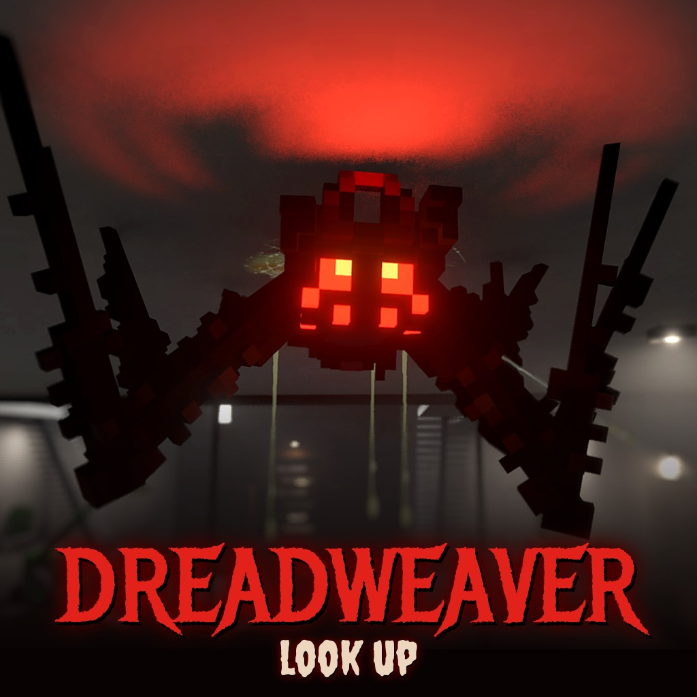

# Dreadweaver - look up

On the Steam Workshop: [Dreadweaver](https://steamcommunity.com/sharedfiles/filedetails/?id=3837295009)

**A man-sized spider with eight glowing red eyes hunts you on any map.** It crawls on floors, walls and ceilings, shoots a web line across open air and rides it, and spits webs that stick to whatever they hit. It stalks you in silence, from above and behind. You only hear what it really sounds like once it comes for you.

## How it hunts
- It hunts by **sight**: stay out of its line of sight and it loses you. Glass does not hide you, and a flashlight shows you from farther away. Noise only tells it where to go and look.
- It **stalks first**: it picks a spot above or behind you, creeps closer, and freezes or scuttles off when you look straight at it. Then it screeches and comes.
- In a hunt it **spits a web**, runs you down, **leaps** and **bites**. After a bite or two it often backs off into the dark and starts again.
- It goes **through glass** instead of round it (not while it stalks: that it does quietly).
- It reads every map on its own: no markers needed.

## Its webs
- A web on a floor, wall or ceiling **slows you to a crawl** while you touch it. A web shot that hits you wraps you for a few seconds.
- The **lines** it shoots to cross gaps stay strung. Touching one slows you too, and the spider uses its lines again to get around.
- It feels anyone caught in its webs, from far away.
- Webs fade after a few minutes, and an explosion tears them away.

## It talks
With [Proximity Comms](https://steamcommunity.com/sharedfiles/filedetails/?id=3812301496) turned on as well, the Dreadweaver **calls to you in a human voice** while it stalks ("Hello? I'm hurt.", "Over here.", "Behind you."), and it **hears what you say** in the chat, typed or spoken, and comes to look. Without Proximity Comms it simply stays silent.

## Fighting back
Shoot it (the head hurts most), blow it up, hit it with a sledge. It bleeds green where you hit it. Hurt badly or quickly, it runs, hides, heals and comes back. Killed, another one arrives a couple of minutes later.

## Settings
- **Options** in the Mod Manager: 1 to 3 on each map, or switch spawning on its own **off** and place them yourself from the spawn menu.
- The host can place more from the spawn menu (Creatures > Dreadweaver), up to 6. The marker lies for 7 seconds, counting down, before the spider comes out of it: time to carry it somewhere, or to get away.

## Without enabling the mod (experimental)
The spawn menu has a second entry, **Creatures > Dreadweaver (works without the mod)**. It carries its own copy of the spider, so one can be placed in the sandbox even when Dreadweaver is not enabled under Global mods. Each one is a separate spider with its own webs; it has no weapon API, no spawn limit and no Proximity Comms lures. Tested in single player; whether other players in multiplayer see it is not known yet.

## Multiplayer
The host turns it on under Global mods, and the host's options decide whether and how many spawn on their own. Each player's game draws the spider and its webs itself; the host runs the brain.

## Villagers
With the [AI Villagers](https://steamcommunity.com/sharedfiles/filedetails/?id=3840579200) mod running, the villagers are prey too: the Dreadweaver sees, stalks, webs and bites them just like players, and they see it, fear it and run (or fight back).

## For mod and map makers
Your own weapons can hurt it through two registry strings on the host: **dreadweaver.hitpoints** (where its hit boxes are, written every tick) and **dreadweaver.damage** (append "x y z amount;" per hit).

## Community

Join the [Discord community](https://discord.gg/gNpRewdkxf) to post bug reports and suggestions.

## Install

Subscribe on the [Steam Workshop](https://steamcommunity.com/sharedfiles/filedetails/?id=3837295009), or clone this repository into
`Documents/Teardown/mods/dreadweaver`. Enable it under **Global mods** (in multiplayer the host does).

## Credits

Made by AgeOfAlgorithms and Claude (Anthropic). MIT licence.
